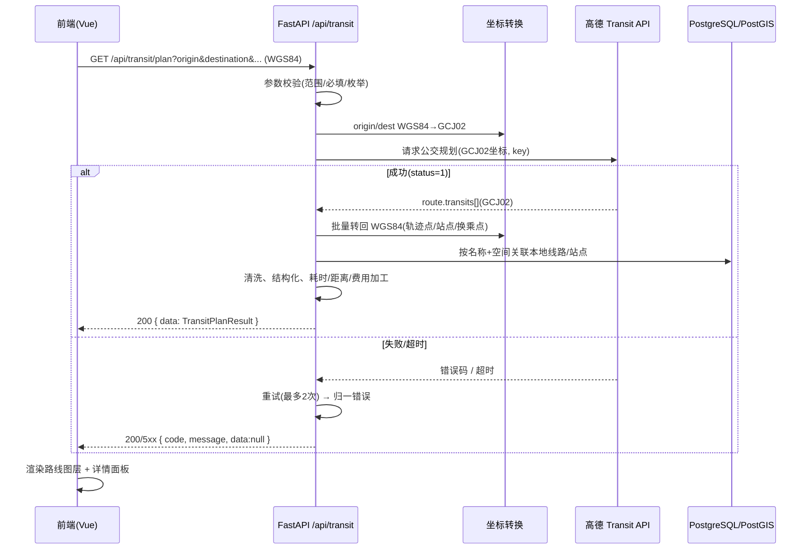

# 公共交通路线规划功能技术实现方案

> 基于高德地图公共交通规划 API（Web 服务 `v3/direction/transit/integrated`），结合项目现有 FastAPI + PostgreSQL/PostGIS 后端与 Vue3 + OpenLayers 前端架构，实现“起终点经纬度 → 公交/地铁/步行混合路线规划 → 地图渲染 + 详情面板”的完整能力。
>
> 本文档仅描述技术方案、接口契约、数据结构、处理流程与渲染规范，不含具体实现代码。

---

## 1. 总体设计

### 1.1 设计目标

1. 提供统一的后端 RESTful 接口，屏蔽高德 API 的坐标、字段、签名细节。
2. 全链路坐标规范：**系统内部、数据库、前端一律使用 WGS84 经纬度 `[lon, lat]`**；仅在调用高德 API 之前做 WGS84→GCJ-02 转换，收到响应后立刻将所有 GCJ-02 坐标转回 WGS84。
3. 规划结果与本地公交/地铁基础数据关联，补全线路、站点业务字段，输出可直接渲染的标准化结构。
4. 前端渲染样式统一：步行虚线、公交蓝色实线、地铁紫色实线、站点/换乘点/方向箭头规范一致。

### 1.2 模块划分

| 模块 | 位置 | 职责 |
| --- | --- | --- |
| 后端接口层 | `backend/app/routers/transit.py` | 接收前端请求、参数校验、统一响应封装 |
| 坐标转换层 | `backend/app/core/coords.py` | WGS84 ↔ GCJ-02 双向转换、批量转换、精度控制 |
| 高德 API 客户端 | `backend/app/clients/amap.py` | 密钥管理、请求构建、超时、重试、响应解析与错误码归一 |
| 数据处理流水线 | `backend/app/services/transit_service.py` | 坐标标准化 → 本地库关联 → 清洗/结构化/业务加工 |
| 数据库关联 | `backend/app/services/transit_match.py` | 线路/站点与本地 `transport` schema 的匹配 |
| 前端服务 | `smarttran/src/common/services/transit.ts` | 调用后端、消费标准化结果 |
| 前端渲染 | `smarttran/src/map2d/layers/transit.ts` + 面板组件 | 路线图层、站点/换乘点、详情面板 |

### 1.3 接口交互时序



---

## 2. 后端接口设计

### 2.1 统一响应格式

所有接口统一返回如下结构（与项目其它路由风格保持一致）：

```json
{
  "code": 0,
  "message": "ok",
  "data": { }
}
```

- `code`：`0` 成功；非零表示业务错误（如 `40001` 参数错误、`50001` 高德调用失败、`50002` 坐标越界、`50003` 无可用路线）。
- `message`：可读提示。
- `data`：成功时为业务对象，失败时为 `null`。

### 2.2 路线规划主接口

**路径**：`GET /api/transit/plan`

**请求参数**：

| 参数 | 类型 | 必填 | 校验规则 | 说明 |
| --- | --- | --- | --- | --- |
| `origin` | string | 是 | `lng,lat`，经纬度合法范围，成都范围内可放宽 | 起点 WGS84 经纬度 |
| `destination` | string | 是 | 同上 | 终点 WGS84 经纬度 |
| `city` | string | 是 | 城市编码，默认 `028`（成都） | 起点城市 adcode |
| `cityd` | string | 否 | 同 `city` 规则 | 终点城市 adcode，跨城时必填 |
| `strategy` | integer | 否 | 枚举见下，默认 `0` | 出行偏好 |
| `date` | string | 否 | `YYYY-MM-DD`，默认今天 | 出行日期 |
| `time` | string | 否 | `HH:mm`，默认当前 | 出行时间 |
| `nightflag` | integer | 否 | `0` 白天 / `1` 夜间，默认 `0` | 是否优先夜班车 |
| `max_alternatives` | integer | 否 | 1–5，默认 `3` | 返回方案数量上限 |

**`strategy` 枚举**（与高德策略一一映射）：

| 值 | 含义 | 高德 `strategy` |
| --- | --- | --- |
| `0` | 推荐路线 | `0` |
| `1` | 少换乘 | `1` |
| `2` | 少步行 | `2` |
| `3` | 不坐地铁 | `3` |
| `4` | 时间优先 | `4` |
| `5` | 地铁优先 | `5` |
| `6` | 公交优先 | `6` |

### 2.3 辅助接口

| 方法 | 路径 | 用途 |
| --- | --- | --- |
| `GET` | `/api/transit/cities` | 返回支持的城市编码列表（默认内置成都 `028`） |
| `GET` | `/api/transit/strategies` | 返回出行策略枚举字典 |

### 2.4 高德 API 调用映射

- **端点**：`https://restapi.amap.com/v3/direction/transit/integrated`
- **请求方式**：`GET`
- **密钥**：固定使用 `78628d55e0e2a0e4bb33db020ae5a749`，通过环境变量 `AMAP_KEY` 覆盖；写入 URL 查询参数 `key`。该 Key 为 Web 服务类型，不可用于前端直连。
- **参数映射**：

| 后端参数 | 高德参数 | 说明 |
| --- | --- | --- |
| `origin`(GCJ02) | `origin` | `lng,lat` |
| `destination`(GCJ02) | `destination` | `lng,lat` |
| `city` | `city` | adcode |
| `cityd` | `cityd` | adcode |
| `strategy` | `strategy` | 0–6 |
| `nightflag` | `nightflag` | 0/1 |
| `date` | `date` | YYYY-MM-DD |
| `time` | `time` | HH:mm |
| — | `show_fields` | 固定 `cost,polyline`，请求费用与轨迹 |
| — | `extensions` | 固定 `all` |

### 2.5 超时与重试

- **连接超时**：3 秒；**读取超时**：8 秒。
- **重试策略**：对 HTTP `5xx`、网络异常、高德返回 `status=0` 且 `infocode` 属于服务端类（如 `10003` 过负荷、`10084` 服务内部错误）时，最多重试 2 次，间隔采用指数退避 + 抖动（200ms、400ms）。
- **不重试**：参数错误（`infocode` 10001/10002 等）、Key 问题（`10007`/`10008`）、无结果（`10003` 但判定为“无路线”）。
- **熔断**：连续 5 次失败后短时间内（30 秒）拒绝新请求，返回 `503`。

### 2.6 密钥与安全

- Key 仅存于后端环境变量，**禁止下发到前端**，禁止写入日志。
- 后端通过 Vite 代理 `/api` 转发，前端不直接接触高德域名。
- 对高德响应中若包含原始请求回显的 `key` 字段需剥离后再返回前端。

---

## 3. 坐标转换处理

### 3.1 全链路坐标规范

| 环节 | 坐标系 | 格式 |
| --- | --- | --- |
| 前端输入 / 数据库存储 / 前端渲染 | **WGS84** | `[lon, lat]` |
| 调用高德 API 时 | **GCJ-02** | `lon,lat` 字符串 |
| 高德返回 | **GCJ-02** | `lon,lat` / polyline |
| 后端处理后输出 | **WGS84** | `[lon, lat]` |

### 3.2 转换算法

- **正向 WGS84 → GCJ-02**：采用公开的偏移算法（与前端 `coordinate.ts` 中 `wgs84ToGcj02` 一致），后端使用同算法的 Python 实现，保证前后端结果一致。
- **反向 GCJ-02 → WGS84**：采用迭代法 `wgs = gcj - delta(gcj)` 迭代 2–3 次收敛；或直接 `wgs84 = gcj02 - (wgs84ToGcj02(gcj02) - gcj02)` 近似。精度满足本场景。
- **中国范围判定**：经度 `72.004–137.8347`、纬度 `0.8293–55.8271` 之外不转换。成都在范围内，必须转换。

### 3.3 精度控制

- 所有坐标统一保留 **6 位小数**（约 0.11 米分辨率），转换后四舍五入。
- 批量转换：对高德返回的 polyline 字符串按 `;` 切分后一次性向量化处理，避免逐点函数调用开销。
- 校验：转换后坐标仍须落在合法经纬度范围，异常点剔除并记录日志。

### 3.4 需转换的字段清单

高德响应中以下字段全部需 GCJ-02 → WGS84：

1. `route.transits[].segments[].walking.steps[].polyline`（步行轨迹）
2. `route.transits[].segments[].bus.buslines[].polyline`（公交/地铁线路轨迹）
3. `route.transits[].segments[].railway.polyline`（地铁/城际轨迹）
4. 所有 `departure_stop`、`arrival_stop`、`via_stops`、`stops` 的经纬度
5. 换乘点位置（由前一段 `arrival_stop` 与后一段 `departure_stop` 取其一，统一为后段出发站坐标）

---

## 4. 后端数据处理流水线

### 4.1 第一步：原始数据坐标标准化与校验

1. 解析高德响应 `route.transits[]`，最多取 `max_alternatives` 条。
2. 遍历每条 `transit.segments[]`，按段类型（步行 `walking`、公交 `bus`、地铁 `railway`）解析。
3. 将所有坐标字段批量 GCJ-02→WGS84 并保留 6 位小数。
4. 校验：
   - 轨迹点数量 ≥ 2，否则丢弃该段。
   - 站点经纬度合法，否则剔除该站。
   - `duration`、`distance` 非负，缺失则由几何估算（polyline 长度 / 平均速度）。

### 4.2 第二步：与本地数据库关联匹配

本地库 `transport` schema 含 `chengdu_bus_routes`、`chengdu_bus_stops_unique`、地铁站点表等。匹配规则：

#### 线路匹配

| 交通类型 | 匹配依据 | 冲突处理 |
| --- | --- | --- |
| 公交 | 1) 名称标准化（去“路”、全角半角统一、大小写）后与 `route_cn` 精确匹配；2) 若多条同线路名，用高德轨迹与本地 `geom` 做 `ST_HausdorffDistance`，取距离最小者；3) 起终点站名一致加权 | 匹配不到则保留高德名称，`matched=false`；匹配到多条且几何相近时，取与当前 segment 起终点空间距离最小的线路 |
| 地铁 | 名称中包含“地铁X号线/轻轨X号线”提取线路号，与本地地铁线路表 `name` 匹配 | 名称冲突时以高德提供的线路号为准 |

#### 站点匹配

| 交通类型 | 匹配依据 |
| --- | --- |
| 公交站 | 站名精确匹配 + 站点位置空间距离 ≤ 150m（`ST_DWithin(geography, 150)`） |
| 地铁站 | 站名 + 所属线路号联合匹配 |

**匹配产物**：为每条线路、每个站点附加本地库主键 `localId`，并标注 `matched: true/false`。前端展示优先用本地字段（如 `company_cn`、`status`），缺失则回退高德字段。

### 4.3 第三步：数据清洗与业务加工

1. **去冗余**：剥离高德原始 `instruction`、`resting`、`distance_cost` 等前端不用字段。
2. **补缺失**：
   - `cost`（费用）：高德返回 `cost` 字段时直接使用；缺失时按本地线路 `basic_prc`/`total_prc` 估算，无数据则 `null`。
   - `stops` 列表：高德公交段提供 `via_stops` + 起终点站，合并为有序站点列表。
3. **耗时与距离**：
   - 分段 `durationSec` 优先取高德 `duration`，缺失用轨迹长度 ÷ 该交通方式均速（公交 25km/h、地铁 35km/h、步行 4.5km/h）估算。
   - 分段 `distanceM` 优先取高德 `distance`，缺失用轨迹点累计长度。
   - 全程 `totalDurationSec` = 各段耗时 + 换乘步行耗时；`totalDistanceM` = 各段距离之和。
4. **换乘逻辑校验**：相邻两段的到达站与下一段出发站空间距离应 ≤ 300m，否则标记 `transferWarning`。
5. **结构化输出**：组装为第 6 节定义的 `TransitPlanResult`。

---

## 5. 数据库关联匹配规则（汇总）

| 维度 | 规则 |
| --- | --- |
| 匹配优先级 | 名称精确 > 名称模糊 > 几何最近 |
| 空间阈值 | 站点 150m、线路 Hausdorff 距离 ≤ 300m |
| 字段冲突 | 本地字段优先；本地缺失回退高德；二者均缺失置 `null` |
| 未匹配处理 | 保留高德数据，`matched=false`，不影响路线渲染 |
| 性能 | 线路名走索引；几何匹配用 `ST_DWithin` + GIST 索引；结果缓存 10 分钟 |

---

## 6. 输出数据结构

### 6.1 顶层结构

```json
{
  "code": 0,
  "message": "ok",
  "data": {
    "origin": [104.066, 30.572],
    "destination": [104.081, 30.670],
    "city": "028",
    "strategy": 0,
    "alternatives": [ ]
  }
}
```

### 6.2 单个方案 `TransitAlternative`

```json
{
  "id": "alt_0",
  "totalDurationSec": 2480,
  "totalDistanceM": 18500,
  "totalCost": 5.0,
  "transfers": 2,
  "walkingDistanceM": 620,
  "tags": ["地铁优先"],
  "segments": [ ]
}
```

### 6.3 单个分段 `TransitSegment`

```json
{
  "type": "metro",
  "lineId": "metro_2",
  "lineName": "地铁2号线",
  "direction": "龙泉驿方向",
  "matched": true,
  "localLineId": 12,
  "departureStop": { "id": "s1", "name": "天府广场", "lng": 104.066, "lat": 30.657, "matched": true, "localId": 88 },
  "arrivalStop":   { "id": "s2", "name": "春熙路",   "lng": 104.081, "lat": 30.655, "matched": true, "localId": 91 },
  "stops": [ { "id": "...", "name": "...", "lng": 104.0, "lat": 30.6, "seq": 1 } ],
  "polyline": [[104.066,30.657],[104.072,30.656]],
  "durationSec": 180,
  "distanceM": 1600,
  "cost": 2.0,
  "transfer": { "toNextType": "bus", "walkingDurationSec": 120, "walkingDistanceM": 90 }
}
```

- `type`：`walk` | `bus` | `metro`
- `transfer`：仅在存在下一段时存在；描述当前段终点到下一段起点的步行换乘。
- `polyline`：WGS84 坐标数组。

### 6.4 步行分段

```json
{
  "type": "walk",
  "departureStop": { "name": "当前位置", "lng": 104.066, "lat": 30.572 },
  "arrivalStop":   { "name": "某公交站", "lng": 104.069, "lat": 30.574 },
  "polyline": [[...]],
  "durationSec": 240,
  "distanceM": 200,
  "cost": 0
}
```

---

## 7. 前端地图渲染规范

### 7.1 路段样式

| 段类型 | 样式 |
| --- | --- |
| 步行 `walk` | 虚线，颜色 `#8FA3B8`，宽度 4px，dash 数组 `[10, 8]` |
| 公交 `bus` | 实线，颜色 `#2979FF`（蓝色），宽度 6px |
| 地铁 `metro` | 实线，颜色 `#7C4DFF`（紫色），宽度 6px |

多方案同时存在时，非选中方案透明度降至 0.35，选中方案完全不透明并置顶。

### 7.2 站点与换乘点标记

| 元素 | 样式 |
| --- | --- |
| 公交站点 | 蓝色空心小圆（半径 5，描边 `#2979FF`，白底） |
| 地铁站点 | 紫色菱形（对角线 10，填充 `#7C4DFF`） |
| 换乘点 | 加大圆形（半径 9），中心显示换乘序号 1/2/3，外圈白色描边 2px |
| 起点 | 绿色圆 + “起” 标签 |
| 终点 | 红色圆 + “终” 标签 |

### 7.3 方向箭头

- 沿 polyline 方向每隔约 80–120 屏幕像素插入一个箭头符号（OpenLayers `RegularShape` 三角形）。
- 箭头颜色与所属路段颜色一致，尺寸 12px，沿行进方向旋转。

### 7.4 图层结构（OpenLayers）

- `transitRouteLayer`：VectorLayer，承载所有路段 polyline。
- `transitStopLayer`：VectorLayer，承载站点与换乘点。
- `transitArrowLayer`：VectorLayer，承载方向箭头（避免与路线样式冲突）。
- 渲染顺序：路线 → 站点 → 箭头；选中方案置于最上层。

### 7.5 详情面板

- 顶部：全程耗时、距离、费用、换乘次数、步行距离。
- 时间轴：按 `segments` 顺序展示，图标区分步行/公交/地铁。
- 每个分段：线路名、方向、起终点站、途经站点数（可展开列表）、耗时、距离、费用。
- 换乘提示：换乘点名称、步行距离/耗时，超 300m 时高亮警示。

---

## 8. 异常处理机制

| 场景 | 处理 |
| --- | --- |
| 参数越界 / 格式错误 | 返回 `code=40001`，400 状态码 |
| 起终点相同 | 返回 `code=50004`，提示“起终点相同” |
| 高德返回无路线 | 返回 `code=50003`，`data=null`，建议更换策略 |
| 高德超时 / 5xx | 重试 2 次后返回 `code=50001`，502/504 |
| Key 失效 | 记录告警，返回 `code=50001`，提示“地图服务不可用” |
| 坐标转换异常 | 异常点剔除，若整段无有效坐标则丢弃该段 |
| 本地库匹配失败 | 不阻断流程，`matched=false`，使用高德数据 |
| 数据库不可用 | 跳过关联步骤，结果仍可返回（降级） |

---

## 9. 性能优化策略

1. **请求层**：httpx 连接池复用（max_connections=20）；高德请求超时 8s；熔断。
2. **缓存层**：
   - 对 `origin+destination+strategy+date+time` 做短期缓存（TTL 60s），避免同一查询重复调用高德。
   - 本地库匹配结果缓存（线路名→本地线路 id）TTL 10 分钟。
3. **数据量控制**：
   - 仅返回 `max_alternatives`（≤5）条方案。
   - polyline 按缩放级别做 Douglas-Peucker 简化（容差 1e-5 度 ≈ 1m），减少前端点数。
4. **转换效率**：批量向量化坐标转换，避免逐点函数调用。
5. **前端渲染**：方案切换时复用 VectorSource，清空后批量 addFeatures；站点标记用 Declutter 避免重叠。

---

## 10. 边界场景处理

| 边界场景 | 规则 |
| --- | --- |
| 起终点距离 < 50m | 直接返回步行方案，不调用公交 API |
| 跨城市 | 要求 `cityd`，否则提示补全 |
| 仅地铁可达 | 正常返回，`segments` 中无 `bus` |
| 仅公交可达 | 正常返回 |
| 仅步行可达 | 返回单段 walk |
| 夜间出行 | `nightflag=1`，优先夜班车 |
| 高德返回的地铁在 `railway` 字段 | 按 `type=metro` 归一，与 `bus.buslines` 中“地铁”类型合并处理 |
| 同名站点多个 | 取空间距离最近者 |
| 费用缺失 | `totalCost` 置 `null`，前端显示“约 ¥X” 或 “—” |

---

## 11. 与现有系统的集成点

1. **后端路由注册**：在 `backend/main.py` 的 `app.include_router` 列表中新增 `transit.router`，前缀 `/api/transit`。
2. **前端服务层**：在 `smarttran/src/common/services/` 新增 `transit.ts`，复用现有 `request` 封装（`http.ts`），自动经过 Vite `/api` 代理。
3. **坐标工具**：后端 `coords.py` 与前端 `coordinate.ts` 的 `wgs84ToGcj02` 算法保持一致；前端补全 `gcj02ToWgs84`（如未来前端直连需要，当前不在前端做转换）。
4. **状态管理**：在 `mapStore.ts` 中新增 `transitPlan`、`selectedAlternative`、`transitLoading`，与地图图层联动（参考现有 `stationBufferResult` 的模式）。
5. **地图引擎契约**：在 `engine.ts` 的地图引擎接口新增 `renderTransitPlan?(result)`，`MapContainer` 通过 watcher 同步到 `Map2DEngine`，再分发到 `layers/transit.ts`。
6. **入口**：在左侧功能栏 `SideRail.vue` 新增“路线规划”入口，激活后展示参数面板与结果面板。

---

## 12. 验证要点

1. 起终点使用成都真实坐标（如春熙路→天府广场），确认高德返回、坐标回转换后与本地底图无明显偏移（目视偏移 < 5m）。
2. 验证公交、地铁、步行三种段类型的渲染颜色和线型符合规范。
3. 验证换乘点序号、站点列表、费用、耗时展示正确。
4. 验证无路线、超时、Key 错误等异常的统一响应。
5. 验证本地库匹配：已知线路名应能匹配到 `chengdu_bus_routes` 的 `localId`。
6. 验证缓存：重复请求相同参数在 60s 内不重复调用高德。
